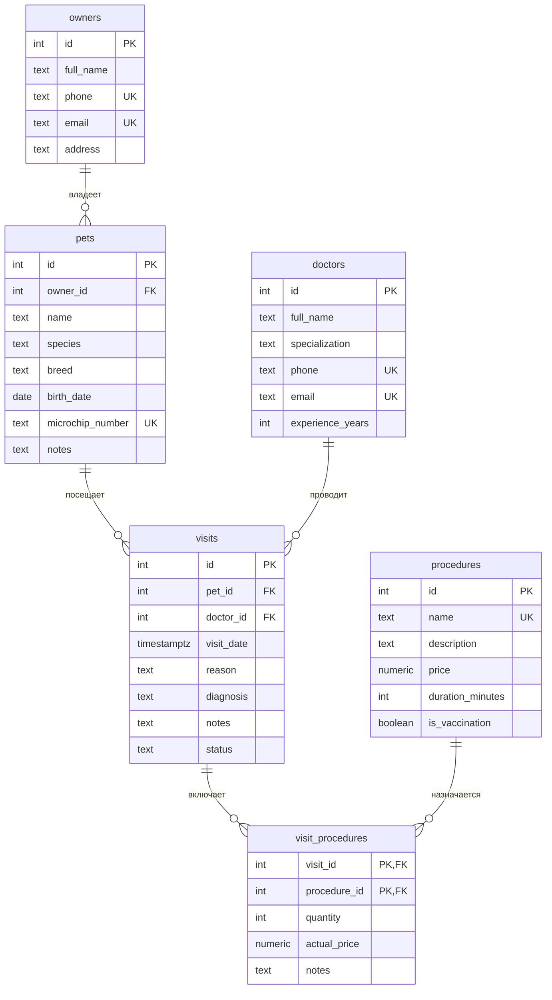

# Ветклиника

Тема № 20: 
**База данных для хранения сведений о владельцах животных, питомцах, ветеринарных врачах, приёмах и процедурах**.

| | |
| --- | --- |
| Главная таблица | pets - животные |
| Связь N:M | Приемы и процедуры через `visit_procedures` |
| Бизнес-правило | Прививка не раньше чем через год после прошлой |
| СУБД | PostgreSQL 17 в Docker |

## Задания курса

Правила курса, установка и порядок сдачи: [docs/README.md](docs/README.md).

| Лаба | Задание |
| --- | --- |
| 1. Модель данных и схема | [docs/lab-1.md](docs/lab-1.md) |
| 2. Запросы | [docs/lab-2.md](docs/lab-2.md) |
| 3. Логика в базе | [docs/lab-3.md](docs/lab-3.md) |
| 4. Транзакции и доступ | [docs/lab-4.md](docs/lab-4.md) |
| 5. Производительность | [docs/lab-5.md](docs/lab-5.md) |
| Витрина к защите | [docs/showcase.md](docs/showcase.md) |

## Как запустить

```bash
cp .env.example .env          # пароли и порт
docker compose up -d          # при первом запуске выполняются скрипты из db/
dbcheck run demo/lab1.sql     # сценарий лабы 1
```

Работа с базой: `docker compose exec db psql -U postgres -d app`. Сценарии выполняются в `psql` командой `\i /demo/lab1.sql`.

После изменения скриптов в `db/` базу нужно пересоздать: `docker compose down -v && docker compose up -d`.

## ER-диаграмма



## Ограничения

| Ограничение | Таблица и колонки | Зачем |
| --- | --- | --- |
| `UNIQUE` | owners.phone | Исключает повторение телефонов владельцев |
| `UNIQUE` | owners.email | Исключает повторение адресов электронной почты владельцев |
| `UNIQUE` | pets.microchip_number | Исключает повторение номеров микрочипов |
| `UNIQUE` | doctors.phone | Исключает повторение телефонов врачей |
| `UNIQUE` | doctors.email | Исключает повторение адресов электронной почты врачей |
| `UNIQUE` | procedures.name | Исключает повторение названий процедур |
| `CHECK` | pets.birth_date | Дата рождения не может быть в будущем |
| `CHECK` | visits.status | Допускаются только статусы «запланирован», «завершён» и «отменён» |
| `CHECK` | doctors.experience_years | Стаж врача не может быть отрицательным |
| `CHECK` | procedures.price | Стоимость процедуры не может быть отрицательной |
| `CHECK` | procedures.duration_minutes | Продолжительность процедуры должна быть положительной |
| `CHECK` | visits.reason | Причина обращения не может быть пустой |
| `CHECK` | visit_procedures.quantity | Количество процедур должно быть положительным |
| `CHECK` | visit_procedures.actual_price | Фактическая стоимость процедуры не может быть отрицательной |


## Нормализация

При проектировании базы данных сведения были разделены на отдельные таблицы, чтобы уменьшить дублирование данных и избежать аномалий при добавлении, изменении и удалении записей.

В исходном варианте все сведения могли бы храниться в одной таблице: владелец, питомец, врач, приём и назначенные процедуры. При этом контактные данные владельцев и врачей повторялись бы в каждой записи о приёме.

**Первая нормальная форма (1НФ).** Каждое поле содержит одно значение, а повторяющиеся группы процедур вынесены в отдельные записи. Данные организованы в таблицах с первичными ключами.

**Вторая нормальная форма (2НФ).** Все неключевые атрибуты зависят от полного первичного ключа. В таблице visit_procedures с составным ключом (visit_id, procedure_id) хранятся сведения, относящиеся к конкретной процедуре в рамках конкретного приёма.

**Третья нормальная форма (3НФ).** Данные владельцев, питомцев, врачей и процедур хранятся отдельно. Например, телефон владельца находится в owners, а не дублируется в таблице visits. Атрибуты каждой таблицы описывают соответствующую сущность, а не другую сущность, от которой они зависят.

Таким образом, нормализация уменьшает избыточность и помогает поддерживать согласованность данных.

### Пример нормализации

В исходной ненормализованной таблице сведения о владельце, питомце,
враче, приёме и процедурах могли бы храниться вместе:

| visit_id | owner_name | owner_phone | pet_name | doctor_name | procedure_name |
| --- | --- | --- | --- | --- | --- |
| 1 | Иван Иванов | +79000000001 | Барсик | Петров П.П. | Вакцинация |
| 2 | Иван Иванов | +79000000001 | Мурка | Сидоров С.С. | Осмотр |
| 3 | Иван Иванов | +79000000001 | Барсик | Петров П.П. | Осмотр |

В такой структуре имя и телефон владельца повторяются в каждой записи.
При изменении телефона пришлось бы обновлять несколько строк.
Удаление последней записи о питомце или приёме могло бы привести к
потере других сведений, если они хранились только в этой таблице.

В нормализованной модели данные разделены по сущностям:
- `owners` хранит сведения о владельцах;
- `pets` хранит сведения о питомцах и ссылку на владельца через `owner_id`;
- `doctors` хранит сведения о врачах;
- `visits` связывает питомца с врачом через `pet_id` и `doctor_id`;
- `procedures` хранит сведения о процедурах;
- `visit_procedures` связывает приёмы с процедурами.

Благодаря этому контактные данные владельца хранятся в одном месте,
а назначение процедуры конкретному приёму представлено отдельной записью.

Таблица `visit_procedures` использует составной первичный ключ
`(visit_id, procedure_id)`. Атрибуты `quantity` и `actual_price`
относятся к конкретной процедуре в рамках конкретного приёма.

Таким образом, неключевые атрибуты соответствуют сущностям и зависят
от ключей своих таблиц, а сведения о владельцах, питомцах, врачах и
процедурах не дублируются в таблице посещений.


## Обоснование типов данных

| Тип данных | Применение | Обоснование |
| --- | --- | --- |
| `INTEGER` | Идентификаторы, количество процедур, стаж | Подходит для целых чисел |
| `TEXT` | Имена, телефоны, адреса, описания | Позволяет хранить текстовые значения переменной длины |
| `DATE` | Дата рождения питомца | Хранит дату без времени |
| `TIMESTAMPTZ` | Дата и время приёма | Позволяет хранить момент времени с учётом часового пояса |
| `NUMERIC(10, 2)` | Стоимость процедур и фактическая стоимость | Обеспечивает точное десятичное представление денежных значений |
| `BOOLEAN` | Признак вакцинации | Хранит логическое значение `TRUE` или `FALSE` |

Для денежных значений используется NUMERIC(10, 2), а не FLOAT, поскольку FLOAT хранит приближённые значения и может приводить к погрешностям при вычислениях.

## Поведение ON DELETE

Для всех внешних ключей используется ON DELETE RESTRICT. Это защищает связанные записи от случайного удаления.

| Связь | Поведение | Причина |
| --- | --- | --- |
| `owners → pets` | `RESTRICT` | Нельзя удалить владельца, пока у него есть питомцы |
| `pets → visits` | `RESTRICT` | Сохраняется история приёмов питомца |
| `doctors → visits` | `RESTRICT` | Сохраняется история приёмов у врача |
| `visits → visit_procedures` | `RESTRICT` | Защищаются записи о процедурах в рамках приёма |
| `procedures → visit_procedures` | `RESTRICT` | Сохраняется история назначенных процедур |

При необходимости удаления таких записей сначала нужно обработать зависимые данные в соответствии с правилами приложения.


## Что сделано по лабам

| Лаба | Что сделано | Сценарий |
| --- | --- | --- |
| 1 | Созданы таблицы, первичные и внешние ключи, ограничения целостности и тестовые данные | `demo/lab1.sql` |
| 2 | ... | `demo/lab2.sql` |
| 3 | ... | `demo/lab3.sql` |
| 4 | ... | `demo/lab4.sql`, `demo/race.sql`, `demo/race_fixed.sql` |
| 5 | ... | `demo/lab5.sql` |

<!--
  Разделы, которые добавляются по ходу курса:
  лаба 1 ★: «Нормализация», «Типы данных»; ★★: «Что происходит при удалении»;
  лаба 4: «Гонка»;
  лаба 5: «Производительность» (таблица до / после, когда индекс не помогает, размеры).
-->
